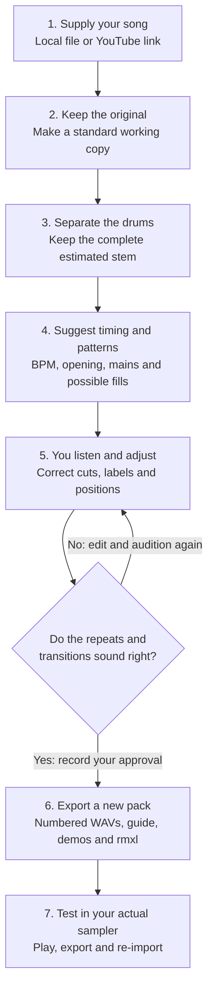
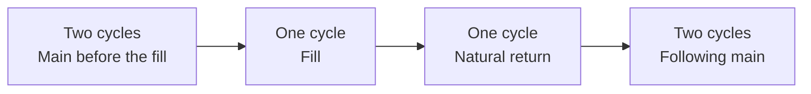
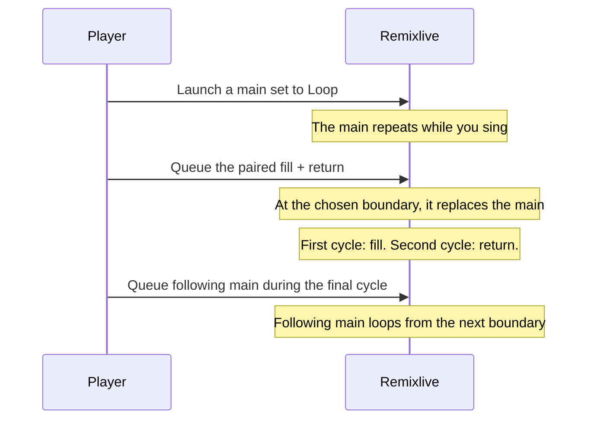
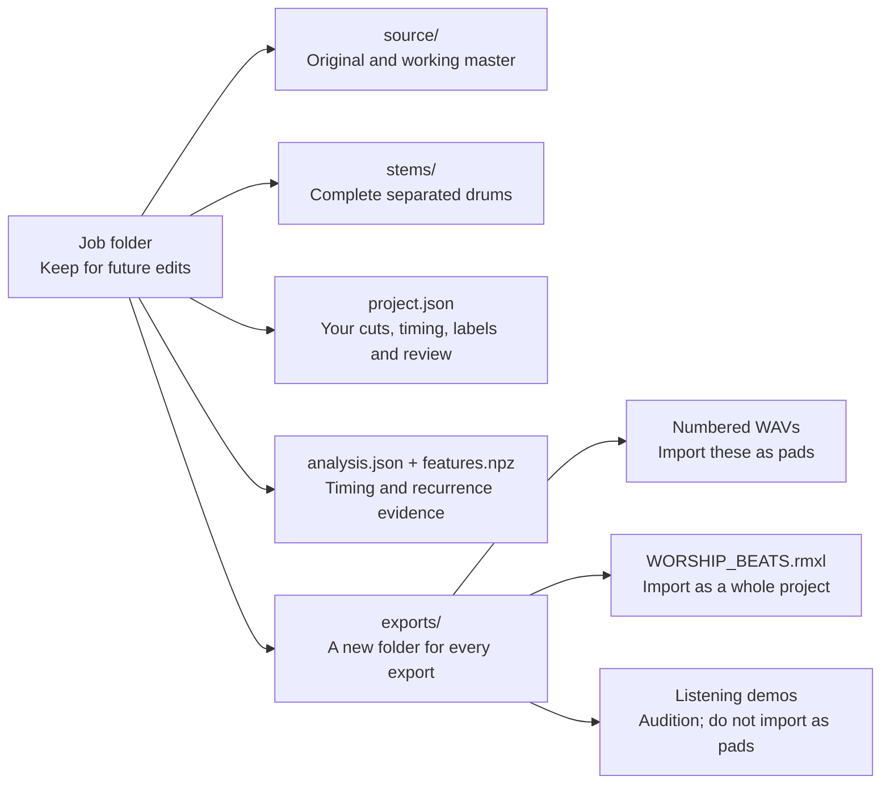
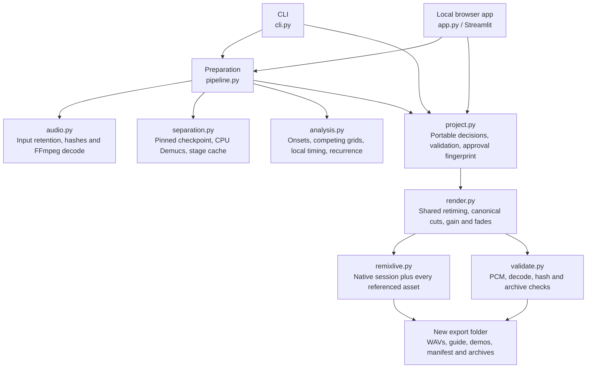
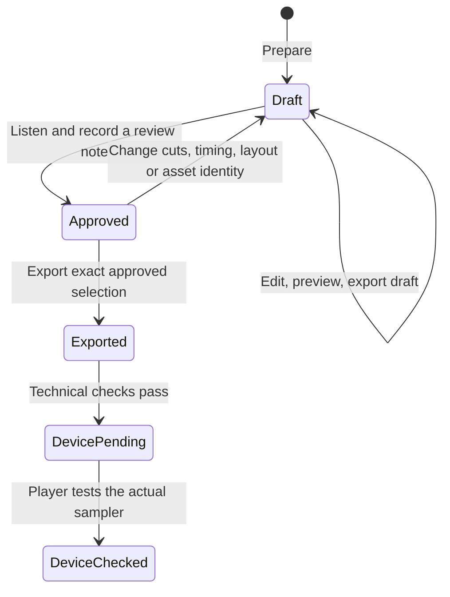

# How the toolkit works

This page starts with the music, then follows the files through the program. You do not need to know Python to understand the first three diagrams. GitHub renders the Mermaid blocks as diagrams; the plain-text equivalent below also works in editors without Mermaid support.

## First, the eight words you need

| Word | Everyday meaning | Example |
| --- | --- | --- |
| Source | The original recording you supply | A song video or `.m4a` file |
| Stem | An estimated part separated from that recording | A file containing mostly drums |
| BPM | How many of the chosen pulses occur in one minute | 120 pulses per minute = one pulse every half second |
| Cycle | A repeatable group of pulses used by the sampler | Four pulses at 120 BPM last two seconds |
| Groove / main | The repeating drum pattern under singing | A two-cycle verse pattern |
| Fill | A short rhythmic change near a phrase ending | A roll before returning to the main |
| Return | The music immediately after the fill | The crash and groove after the roll |
| Pad | A button that plays one exported audio file | Button 01 plays `01.wav` |

A sampler cycle is a practical length. It is not automatically a notation bar. If a compound rhythm can be counted more than one way, decide what a pulse means before using the BPM.

## The whole journey



```text
Your song → retained original + standard copy → estimated drum stem
          → timing/pattern proposals → YOUR listening and corrections
          → numbered WAVs + guide + Remixlive project → device checks
```

**The listening step matters.** A computer can verify that a file has exactly the right length. That does not tell it whether the fill suits the lyrics, the opening feels right, or the drum separation sounds clean enough for worship.

## What is automatic, and what do I decide?

| The software does | You decide |
| --- | --- |
| Retains the source and computes hashes | Which recording and excerpt you want |
| Estimates drums with a separation model | Whether the estimated drum sound is acceptable |
| Finds competing tempo/grid proposals | Which count fits the music and your performance |
| Compares sound patterns across the song | Which distinct patterns you actually need |
| Suggests possible phrase-end cuts | Whether a candidate is the right musical fill |
| Produces repeat/transition demos | Whether those demos sound continuous |
| Checks file lengths and native references | Whether the imported project works on your device |

The program does not read the lyrics or recognize pallavi/charanam from the drums. Enter those section names after checking the performance yourself.

## What a main → fill → return really means

Imagine this neighboring passage in the original recording:



The toolkit can keep several useful cuts of that passage:

```text
Original:       [ main ][ main ][ fill ][ return ][ main ][ main ]
Paired main:    [------ 2 ------]
Short fill:                     [- 1 -]
Fill + return:                  [------ 2 ------]
Following main:                                  [------ 2 ------]
```

The short fill is the beginning of the combined fill/return, taken from the same audio. The source boundary between neighboring pieces must meet exactly. Processing a timing family together helps preserve this relationship when adjusting tempo.

Why not take a random main and a random fill at the same BPM? They may come from different rooms, mixes, drum intensities or timing sections. Equal BPM alone does not establish a natural handoff.

## What happens when I press a pad?



This describes the intended playing route. Confirm the actual quantization and column behavior in your app version. A One Shot does not automatically recall a main. Different columns can overlap, so changing columns needs a coordinated stop/start or a copy in the active column.

## Files: what to keep and what to import



Your editable project uses relative references to the master and stem. Moving the **whole job** preserves these links. Moving `project.json` alone does not move its audio. The exported decision snapshot is an audit record; it is not a self-contained editing project.

## Architecture for developers

Both interfaces call the same engine. There is no separate hidden AI service.



### Boundaries and dependencies

| Stage | Main dependency | What it saves | Cached behavior |
| --- | --- | --- | --- |
| Download | yt-dlp | Original audio and download metadata | yt-dlp can retain download state |
| Decode | FFmpeg | Stereo 44.1 kHz master, source hashes | Verified completed decode is reused |
| Separate | Demucs + Torch | Complete drum/accompaniment stem and model provenance | Verified completed separation is reused |
| Analyze | NumPy, SciPy, librosa, soxr | Timing candidates, local grids, cycle descriptors | Explicit saved evidence; preparation protects existing decisions |
| Review | Streamlit or direct JSON editing | Project decisions and listening note | Edits invalidate prior approval |
| Render | FFmpeg, soxr, SoundFile | Exact-length PCM files and demos | Retimed working audio is cached |
| Package | Python zipfile and JSON | `.rmxl` and WAV ZIP | Every export is a new version |

An interrupted neural inference starts over. The stage cache is not an audio-chunk checkpoint system.

### Timing arithmetic

```text
seconds per pulse  = 60 / target_BPM
frames per cycle   = round(44100 × seconds_per_pulse × pulses_per_cycle)
frames in a pad    = whole_cycles × frames_per_cycle
```

At 120 BPM and four pulses per cycle, a cycle is exactly 88,200 frames. A two-cycle pad contains 176,400 frames, or four seconds. With a BPM that produces fractional frames, all cuts share the same canonical rounded cycle length. Two separate endpoints are not independently snapped to nearby drum hits.

Source time and output time are different when retimed. Each pad records its source start and original source cycle duration. A shared timing-family render converts that family to the target cycle length. The renderer checks the sample boundaries of declared adjacent routes after conversion.

### Review state



`human_listening_approved`, `passed` technical validation, and app/device verification are distinct facts. The program does not automatically promote file checks into musical or device approval.

### Important project fields

| Field | Meaning |
| --- | --- |
| `schema_version` | Project format version; currently 1 |
| `source` | Input provenance, requested excerpt and hashes |
| `stem`, `stem_sha256` | Relative stem reference and expected contents |
| `separation` | Mode, model checksum, shifts and bypass declaration |
| `target_bpm` | Output sampler pulse rate |
| `pulses_per_cycle` | Number of chosen sampler pulses in a cycle |
| `notation_meter` | Optional human notation label; not inferred |
| `grid` | Proposed source timing; changing phase alone does not move saved cuts |
| `pads` | Number, section, role, mode, source start/period and cycles |
| `columns` | Three arrays, one per vertical column; 0 means empty |
| `routes` | Pairs required to be source-contiguous |
| `fill_pairs` | Short-fill and combined-fill pads that must share raw prefix audio |
| `demos` | Sequences concatenated for listening |
| `review` | Note and fingerprint of the approved exact selection |

See [the sanitized example](../examples/README.md) and [command reference](commands.md) for concrete use.
