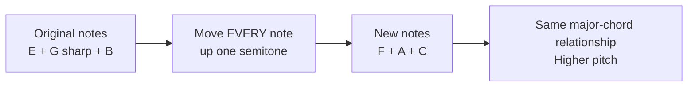
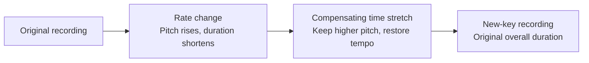

# Why changing the key keeps the song recognizable

## A melody depends on relationships between notes

You can sing the same tune higher or lower and still recognize it. Transposition does the same thing to every pitched note. The distance between notes stays the same, so the melody and harmony keep their shape.

An E major chord contains **E, G♯ and B**. Move every note up one semitone—the smallest step between neighboring piano keys—and it becomes **F, A and C**, an F major chord. Move the original up three semitones and it becomes **G, B and D**, a G major chord.

| Example progression | Original E major key | Up 1 semitone: F major key | Up 3 semitones: G major key |
| --- | --- | --- | --- |
| First chord | E | F | G |
| Second chord | G♯m | Am | Bm |
| Third chord | C♯m | Dm | Em |
| Fourth chord | B | C | D |

This is an illustrative progression, not an automatic transcription of any song. A minor chord stays minor when all its notes move together. Changing the key of a major song does not automatically make it minor.



## How can software change instruments already recorded?

A recording stores the changing air pressure of the combined sound as samples. It usually does not contain separate labels saying “piano plays E” or “violin plays B.” Sound-processing software can change the frequencies in that combined waveform without knowing which instrument made them.

In equal-tempered tuning, the pitch multiplier for a shift of `n` semitones is:

```text
pitch multiplier = 2^(n / 12)
```

One semitone is about ×1.05946. Three semitones are about ×1.18921. Multiplying every pitched component by the same ratio preserves the frequency ratios that define intervals and chords. Simply adding a fixed number of hertz to every component would not do that.

## Three different ways of changing music

| What you have | What a transpose setting changes | What happens to the instrument sound |
| --- | --- | --- |
| MIDI / a keyboard instrument | Changes the notes sent to the instrument | The instrument renders the new pitches using its own synthesis or samples |
| One finished mixed recording | Processes the recorded waveform | Every audible component is affected, including drums and leftover vocal traces |
| Separate stems | Processes selected parts independently | Pitched stems can move while the drums stay unchanged |

On a keyboard, pressing the same physical key after transposing sends a different musical note. On a recording, there are no playable keys left; the software transforms the audio. Both can change the key, but their effect on tone can differ.

## Pitch, speed and tempo are different controls

Playing recorded samples faster raises their pitch and makes the song shorter. Playing them slower lowers pitch and makes it longer. To change key while keeping tempo, use an algorithm that controls pitch and duration separately, or combine a pitch/speed change with compensating time stretching.

For the E→F and E→G files made in this conversation, FFmpeg's `asetrate` changed the playback-rate interpretation, `aresample` produced a normal 44.1 kHz file, and `atempo` compensated for the speed change. The result was padded/trimmed to the original duration. The source was treated as E major based on the supplied key; no automatic key verification was claimed.



FFmpeg documents these filters in its [official filter reference](https://ffmpeg.org/ffmpeg-filters.html#asetrate) and [tempo filter documentation](https://ffmpeg.org/ffmpeg-filters.html#atempo). A build with [Rubber Band support](https://ffmpeg.org/ffmpeg-filters.html#rubberband) offers direct pitch/tempo controls and formant options.

## Does the original sound stay exactly the same?

The musical identity is largely preserved, but the recorded tone is not guaranteed to remain identical. A piano can sound brighter when shifted up. Strings may change color. A singer's vocal resonances, called **formants**, may move and make the voice sound smaller or deeper. Formant-preserving processing can help, but is not perfect. Cymbals, reverb and sharp attacks can acquire processing artifacts.

Larger shifts usually expose more of these changes. A mixed file gives fewer controls than separate stems or the original MIDI/instrument session. Re-rendering the original instruments in a new key can produce a more natural result than heavily shifting the finished mix.

For live worship, transpose the accompaniment to the chosen key and sing the melody in that same key. An instrument you play alongside must also use the new key. Ordinary drums generally do not need to be transposed, although tuned percussion and bass parts can have meaningful pitches.

**Changing the key** moves the whole harmonic structure. **Changing one chord** is an arrangement edit: a single global transpose setting cannot replace only that chord while keeping every other note unchanged.
