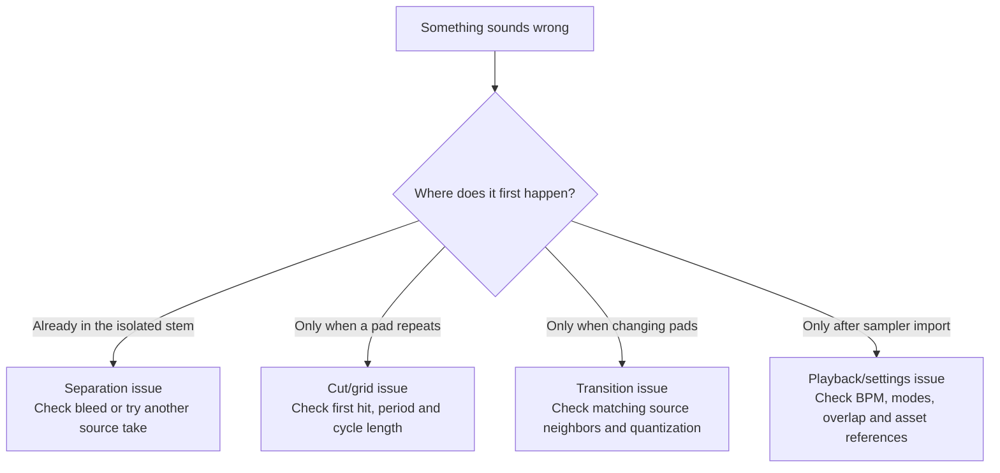

# Troubleshooting by what you hear or see

Start with the symptom. Keep the original job and make a new export after corrections.



## Installation or startup

**`command not found: worship-beats`**: activate `.venv` or run `.venv/bin/worship-beats`. Do not install into an unrelated system Python to repair a PATH issue.

**`No module named ...`**: run `bash scripts/setup_mac.sh` from the repository. `doctor` reports optional modules independently. Separation needs Demucs/Torch; the browser app needs Streamlit. Python 3.14 is outside this release's supported range.

**Torch wheel unavailable on an Intel Mac**: the setup script selects Python 3.11 and Torch/torchaudio 2.2.2 with NumPy below 2. Do not reuse the Apple Silicon Python 3.13 lock. Intel hardware remains untested in the release report.

**Double-click launcher closes**: open Terminal in the repository and run `bash Launch.command` so the error stays visible. Run the setup script first.

**Port already in use**: an earlier app may still be running. Stop its Terminal with Control-C or launch manually with a different localhost port:

```bash
.venv/bin/python -m streamlit run src/worship_beats/app.py \
  --server.address=127.0.0.1 --server.port=8502
```

## Download or separation

**YouTube unavailable / sign-in restriction / HTTP error**: supply your own accessible local media. Updating yt-dlp may fix an extractor change; do so in the environment and recheck the job. This tool does not collect browser cookies or bypass access restrictions.

**Model checksum failed**: the checkpoint is rejected before loading. Remove only the damaged model cache entry named in the error and download it again. Do not disable checksum verification.

**Processing seems stuck**: neural separation on CPU can take longer than playback. Look at Terminal's segment progress and CPU activity. A new process starts inference again if the previous inference did not finish; only completed verified stages are reused.

**Vocals, keyboard, guitar or room sound remain in drums**: separation is an estimate. Compare other repeated takes and choose a cleaner one. More shift averaging may help but is not a guarantee. Strong filtering can remove cymbals and body along with the bleed. A different source recording may be the better solution.

**Source is silent / too short**: confirm the excerpt times and play the retained master. The rhythm analyzer needs at least eight seconds of active material and at least six usable cycles. A free-time instrumental intro may need a later steady excerpt.

## Loop timing

**It starts with an unwanted gap**: inspect the first intended attack, source start and pre-attack. The grid may be late, or the chosen source bar may begin with a real rest. Move the whole window while preserving its cycle length.

**It clicks at the repeat**: listen to the repeated demo. Confirm the opening attack is not being chopped. Edge fades reduce discontinuities; they cannot fix a cut in the middle of a sustained unrelated sound. Try another matching take.

**It drifts gradually**: check source cycle period and competing BPM interpretations. Compare opening, middle and later local grids. Do not independently snap both ends to different hits. Fit a correct period and process the related route together.

**It suddenly goes off after one point**: inspect for a tempo change or edit. Use section-specific timing and separate routes across discontinuities. A single global grid is insufficient for some live recordings.

**The BPM seems half/double or 2:3-related**: count the same phrase using each interpretation. Choose the pulse/grouping whose whole motifs and phrase boundaries make sense. Quantization is expressed in pulses, not automatically notation bars.

**`Non-contiguous declared route`**: declared adjacent pads must meet in the original audio and share the same source period. Either correct both cuts or remove a route that was never meant to claim source adjacency. A listening sequence can still demonstrate a non-adjacent arrangement without declaring it source-contiguous.

**`Separated fill is not the prefix`**: make the short fill start at the same source location as its combined fill/return, use the same period, and keep its length within the longer cut.

## Remixlive

**Two drums play at once**: full drum pads replace each other. Check Multiple Mode, stop the outgoing column, and keep matched routes in the same vertical column when possible. Different columns can overlap.

**Fill stops and there is silence**: a One Shot does not automatically recall the main. Queue the following main during the final cycle. Alternatively, use an intentionally combined repeating phrase that already contains main/fill/return.

**The WAV sounds correct but the imported pad is wrong**: check project BPM, beat metadata, pitch/time-stretch settings, quantization, Loop/One Shot and Repeat. Compare one pad with the listening demo before changing all cuts.

**Sharing/export fails**: validate the native archive and confirm every referenced asset exists, including `samples/Song_8x6.song`. Import the newly built project, then export and re-import it in the actual app. Complete ZIP references do not by themselves prove a successful app round trip.

**A demo exceeds 20 seconds**: demos are intentionally not sampler pads. Import only the numbered WAV files, each of which must remain under the limit.

## Approval and saved jobs

**Export asks for approval again**: an edit changed the selection fingerprint. Audition the updated repeated loops and transitions, then approve with a note. `--draft` remains available for auditioning.

**Job already exists**: review its `project.json` or choose a new job name. The toolkit preserves decisions and exports instead of overwriting them.

**Asset missing after moving folders**: move the complete job, including source and stems. Relative paths must stay inside the job. An export snapshot alone is not the original editing project.

For a useful bug report, include command, OS/architecture, Python version, `doctor` output, traceback and a sanitized project description. Exclude songs, private links, cookies, model weights and personal filesystem paths unless you intend to share them.
